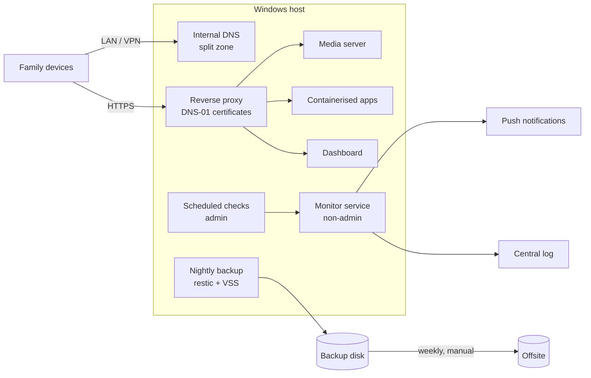

# Running a family home server like production

This is the story of how I built and run a small home server from scratch. It is one consumer laptop running Windows,
and the whole family uses it every day for media, files, DNS and remote access. The list of services is not the
interesting part. The interesting part is the engineering around them:

- backups that are proven by restore tests;
- least privilege on a Windows host;
- deterministic monitoring;
- written-down decisions and incident write-ups.

Related code:

- [homelab-monitor](https://github.com/barcsaidominik/homelab-monitor): a deterministic incident engine and alerting (.NET 10)
- [Jellyfin-API-Key-Middleware-Plugin](https://github.com/barcsaidominik/Jellyfin-API-Key-Middleware-Plugin): a per-API-key allowlist for Jellyfin (ASP.NET Core middleware)

## Context and constraints

- **One machine.** A gaming laptop with consumer hardware: an internal SSD, a large USB disk, no rack. The only UPS is
  the battery.
- **Windows as the host OS.** This was a given, not a choice I re-argue here. It runs native Windows services next to
  Docker Desktop containers.
- **Users who are not technical** and must not notice maintenance.
- **One operator with a day job.** That is me, so everything has to work without me watching it.

One constraint shaped most of the decisions: **nothing may depend on someone being signed in.** Windows Update is allowed
to reboot the machine at night, and everything has to come back on its own.

## Architecture (as of November 2026)

Only one port is forwarded from the router: the media server's own remote-access port. Everything else is reachable
only on the LAN or through a mesh VPN, and family members outside the house use the same names and certificates as at
home.

## Case studies

Each case study follows the same pattern: the problem, the options, what I decided, how I proved that it works, and
what it cost. The details are in the [decision records](docs/adr/README.md).

### 1. Backups that are proven, not assumed

When I started, there was no systematic backup. Now a nightly job takes **restic** snapshots with a **Volume Shadow
Copy** snapshot underneath, so no service has to stop. Every SQLite database is first copied with the online backup
API, inside the container where needed, and the copy is checked with `PRAGMA integrity_check`. A typical night takes
under three minutes ([ADR-001](docs/adr/001-nightly-backup-without-downtime.md)).

I did not copy the 2.9 TB media library, because it can be re-obtained. Instead, a weekly job keeps a SHA-256 manifest
of it, so after a disk failure I know exactly what is gone ([ADR-002](docs/adr/002-media-manifest-instead-of-copy.md)).

Restores are tested on two levels ([ADR-003](docs/adr/003-restore-testing.md)):

- **Weekly, automated:** `restic check` on a random 10% of the data, then a restore into a sandbox where every
  database copy is checked.
- **On request:** every service is started from its restored data in an isolated container with no network. The
  first run passed 26 out of 26.

This proves that the data and the services can be restored, not that the whole host can be. The bare-metal rebuild is
written down step by step, but it has not been tested.

The offsite copy is a manual weekly upload from my desktop. The desktop reads the backup through a read-only share, so
**the server holds no cloud credentials** that ransomware could use against the offsite copy
([ADR-004](docs/adr/004-offsite-without-stored-credentials.md)).

### 2. Unattended startup on Windows without AutoLogon

After a reboot, only real Windows services came back. Docker Desktop, and with it every container, needed someone
signed in. I had used AutoLogon before, and it got in the way of RDP and local sign-in, so I did not want it back.

Instead, every app now starts from a scheduled task at boot, in session 0. A small wrapper starts an app only when its
data volume is mounted **and** has the expected unique id. That prevents a quiet failure: the disk does not mount, and the
app creates an empty library on the system drive.

The proof is a test script with one PASS/FAIL line per item. Before the change, signed in, it showed 44/44. After three
reboots without anyone signing in, it showed 53/53 ([ADR-005](docs/adr/005-unattended-startup-without-autologon.md)).

### 3. Least privilege on a Windows host

A read-only security assessment found two things:

- **The "limited" setting did nothing.** The media servers ran from scheduled tasks under my admin account with the
  limited run level, and I measured that they still got a **full admin token**.
- **A local path to SYSTEM.** A SYSTEM service started its binary from a folder that every authenticated user could
  write to.

I moved every long-running app to **its own non-admin account**, one service at a time. Each account can write only
where it has to, and it is explicitly denied access to the other services' data. Each move had its own script with a
rollback, and was followed by a token check and a reboot test.

I tested the hardware video transcoding *before* the move, because losing it would have made the change pointless. The
folder permissions were fixed with a backup of the old ACL kept. The monitor runs as a virtual service account, with
no password at all ([ADR-007](docs/adr/007-per-service-accounts.md)).

### 4. Internal names and TLS without exposing anything

The internal services moved from a free dynamic-DNS name to my own domain. My local DNS server is authoritative only for
a dedicated subzone (`home.<domain>`). The public website and the mail records therefore never depend on the home
server: if it is down, they still resolve.

The certificates come through ACME DNS-01 with an API token that can edit one zone and nothing else. The migration had
a rollback for every phase. Certificates were requested from the staging environment first, and the old name stayed
until the new ones had passed the test matrix. Certificate expiry is now a monitored check
([ADR-006](docs/adr/006-internal-subzone-and-dns01.md)).

### 5. Monitoring that wakes me up only when it should

Light probes run every minute: HTTP, DNS, services, processes, TLS and a fan state file. Privileged checks run in a
scheduled script. Both feed an **incident state machine** with hysteresis, dependency suppression, flapping detection
and maintenance windows. When DNS fails, the result is one incident with the affected services listed, not five alerts.

Only a short, explicit list of critical events sends a push notification. A dead man's switch at healthchecks.io covers
the case where the monitor or the whole machine is gone. The monitor ran in shadow mode for a week before it sent
anything. That week found one false critical (a probe that depended on GitHub being up) and one missing critical (the
fan incident below). Both were fixed, notifications were switched on, and a live test confirmed the whole chain
([ADR-009](docs/adr/009-narrow-notifications-and-heartbeat.md)).

I evaluated an LLM-based "AI operator" and rejected it for concrete reasons: privacy, the admin access it would need,
and a GPU that is already busy with transcoding ([ADR-008](docs/adr/008-no-llm-in-operations.md)). The code is in
[homelab-monitor](https://github.com/barcsaidominik/homelab-monitor).

### 6. Incidents and what changed after them

**DNS down for six and a half hours after a routine update.**

- *Timeline:* At 02:00 the weekly update window installed a .NET runtime update. Windows restarted the DNS service as
  part of it, but the new runtime was not in place yet, so the service failed to start and stayed stopped. There was no
  reboot, so the startup checks never ran. The six-hourly health check reported it at 06:15. I noticed in the morning
  and switched the clients to public DNS by hand.
- *Root cause:* a service restart inside an update, plus nothing that watches a stopped service between health checks.
- *Fix:* a watchdog task that runs every five minutes and also reacts to the service control manager's failure events.
  It starts the service if it is set to automatic and is stopped. Tested live: I stopped the service on purpose, and the
  outage lasted 17 seconds.
- *Prevention:* DNS became a critical, notifying check in the new monitor, so the next time I would hear about it in
  minutes, not hours.

**Fans at 0 RPM after an unattended reboot.**

- *Timeline:* After several reboots without anyone signing in, the CPU reached 98–100 °C while the fans stood at
  0 RPM. The monitor opened an incident for it, and I saw it in the log, not on my phone. Notifications were still
  in shadow mode, but the shadow week showed that this incident was only a warning, so it would not have notified
  me even with sending switched on. It is a critical, notifying check now.
- *Wrong first hypothesis:* a hardware or cooling fault. I cleaned the fans and reset the embedded controller, and after
  the next boot without anyone signing in they still stood at 0 RPM. They started as soon as I signed in.
- *Root cause:* on this laptop the fan curve comes from the vendor's desktop app, and that app runs only in a signed-in
  session. Without it, the embedded controller leaves the fans stopped.
- *Fix:* a fallback fan controller writes the fan level through the firmware's WMI interface, but only when the vendor
  app is not running. It also has an emergency "full speed" rule. I verified it with a boot without signing in.
  Replacement tools that write the controller's registers directly were rejected, because nobody had verified them on
  this model.
- *Lesson:* find out what actually controls a piece of hardware before blaming the hardware. And "unattended startup"
  ([ADR-005](docs/adr/005-unattended-startup-without-autologon.md)) has side effects that show up only later.

### 7. Risks that were accepted on purpose

Not everything gets fixed. Some container ports stay open on all interfaces, because some devices reach those services
only by IP and port. The log server accepts events without authentication. There is only one DNS server. The backup
shares a disk with the media.

Each of these is in a register with the reason, what limits the risk, and the condition that would reopen it
([ADR-010](docs/adr/010-accepted-risks.md)). Writing down what is *not* fixed, and why, is part of the design. It also
stops the same trade-off from being argued again every month.

## Working with an AI assistant

I wrote most of the scripts, code and documentation together with Claude (Claude Code). These are the rules that kept
it safe and reviewable:

- **I make the decisions.** Every decision record says who decided, and the assistant's proposals are marked as proposals.
- **Assess first, change second.** Every change starts with a read-only assessment. Before anything risky, there is a
  backup of the current state and a rollback path.
- **Shadow mode before acting.** Anything that can act or notify runs first without doing so.
- **Evidence or it did not happen.** "Done" means a test result, a restore report or a measurement. A worrying
  conclusion is measured again before anyone acts on it. Several claims in this repository were corrected while I wrote
  it, because the records did not support them.
- **Independent review before publishing.** Before a repository goes public, a separate review checks it for leaked
  specifics and for code or text that does not match the facts.

## What is deliberately not in this repository

Real names, addresses, domains, accounts, the exact firewall configuration and open audit findings. The patterns are
general. The specifics would only be a map for an attacker.

## Decision records

See [docs/adr](docs/adr/README.md).

## License

The text of this repository is licensed under [CC BY 4.0](LICENSE): you may share and adapt it with attribution.
