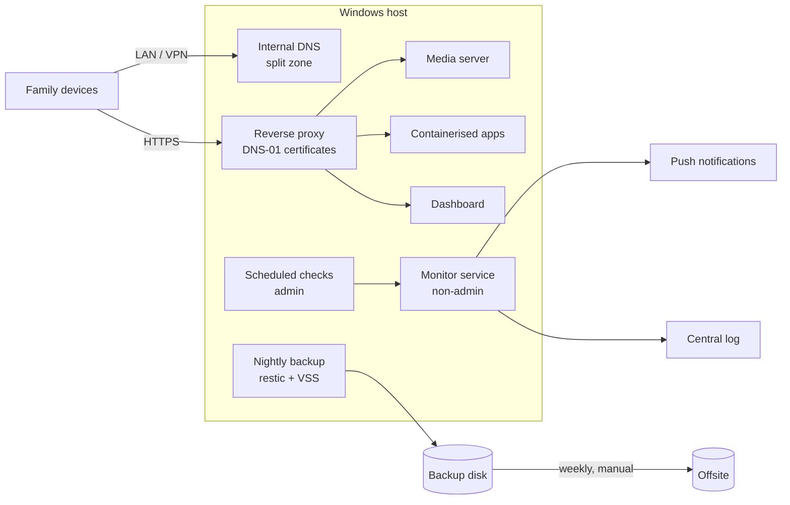

# Running a family home server like production

> **Draft.** Sections marked _TODO_ are outlines, not final text.

A case study of building and operating a small home server from scratch: one consumer laptop running Windows, used
every day by the whole family for media, files, DNS and remote access. The interesting part is not the list of
services but the engineering around them: backups that are proven by restore tests, least privilege on a Windows host,
deterministic monitoring, documented decisions and incident write-ups.

Related code:

- [homelab-monitor](https://github.com/barcsaidominik/homelab-monitor): deterministic incident engine and alerting (.NET 10)
- [Jellyfin-API-Key-Middleware-Plugin](https://github.com/barcsaidominik/Jellyfin-API-Key-Middleware-Plugin): per-API-key allowlist for Jellyfin (ASP.NET Core middleware)

## Context and constraints

_TODO (short):_ one machine (laptop, consumer hardware, no rack, no UPS beyond the battery), Windows as the host OS
(not a choice to re-litigate here), a mix of native Windows services and Docker Desktop containers, non-technical
users who must not notice maintenance, one operator with a day job. Constraint that shaped most decisions:
**no admin session should be needed for anything to work** (the machine reboots unattended after updates).

## Architecture

_TODO:_ generic diagram, no real names or addresses.

## Case studies

Each one: the problem, the options, the decision, how it was verified, and what it cost.

### 1. Backups that are proven, not assumed

_TODO:_ nightly restic snapshots with VSS, no downtime (online SQLite backup API instead of stopping services);
media is re-obtainable, so only a file list + SHA-256 manifest is kept instead of terabytes of copies; a weekly
automated restore test into a sandbox with sampled data verification; service-level restore tests in isolated
containers with networking disabled (no VM needed); offsite as a manual weekly upload, because the host holds **no
cloud credentials** a ransomware infection could use. Evidence: restore test report (26/26), RPO/RTO table.
→ ADR-001…004

### 2. Unattended startup on Windows without AutoLogon

_TODO:_ services that normally live in a user session (tray apps, Docker Desktop) started by scheduled tasks at boot;
a wrapper that waits until the media volume is mounted *and* is the expected volume (by its unique id) before starting
anything that writes to it; why AutoLogon was rejected. → ADR-005

### 3. Least privilege on a Windows host

_TODO:_ moving media, download and app services from the admin account to per-service non-admin accounts; the
measurement that a "limited" scheduled-task logon still produced a fully elevated token; closing a local privilege
escalation path (a SYSTEM service binary in a folder writable by ordinary users) with an ACL change; the monitor as a
virtual service account with no password at all. → ADR-007

### 4. Internal names and TLS without exposing anything

_TODO:_ a dedicated internal subzone so the public zone (mail, a public site) never depends on the home server;
certificates via ACME DNS-01 with a token scoped to one zone; certificate expiry monitored like any other check.
→ ADR-006

### 5. Monitoring that wakes you up only when it should

_TODO:_ summary of homelab-monitor: light probes + privileged scheduled checks, an incident state machine with
dependency suppression, a narrow set of push notifications, a dead man's switch, shadow mode before go-live; why an
LLM-based "AI operator" was evaluated and rejected. → ADR-008, ADR-009

### 6. Incidents and what changed after them

_TODO:_ two short post-mortems (timeline, impact, root cause, fix, prevention):

- **DNS down for six hours after a routine update.** The weekly update window restarted the DNS service before the
  new runtime it depended on was installed; the service stayed stopped. Fix: a watchdog that reacts to the service
  control manager's failure events, plus the DNS check became a critical, notifying check.
- **Fans at 0 RPM after an unattended reboot.** On this laptop the fan curve is driven by the vendor's desktop app,
  which only runs in a logged-in session; without it the embedded controller left the fans stopped under load.
  Fix: a fallback fan controller through the firmware's WMI interface, active only when the vendor app is absent,
  and a monitor check for "both fans stopped while hot". Lesson: verify what actually controls the hardware before
  blaming the hardware.

### 7. Risks that were accepted on purpose

_TODO:_ a short register with the reason for each (e.g. some container ports stay on all interfaces because devices
reach them by IP and port; the log server accepts unauthenticated ingestion on localhost; no automatic offsite).
Writing down what is *not* fixed, and why, is part of the design. → ADR-010

## Working with an AI assistant

_TODO:_ most of the scripts, code and documentation were written together with Claude (Claude Code). How that was
kept safe and reviewable: the owner makes every decision (recorded with who decided it), read-only assessment before
any change, backups and a rollback path before every risky step, shadow mode before enabling anything that acts,
"done" is only claimed with evidence (tests, restore reports, measurements), and an independent review before
anything is published.

## What is deliberately not in this repository

Real names, addresses, domains, accounts, the exact firewall configuration and open audit findings. The patterns are
general; the specifics would only be a map for an attacker.

## Decision records

See [docs/adr](docs/adr/README.md).
